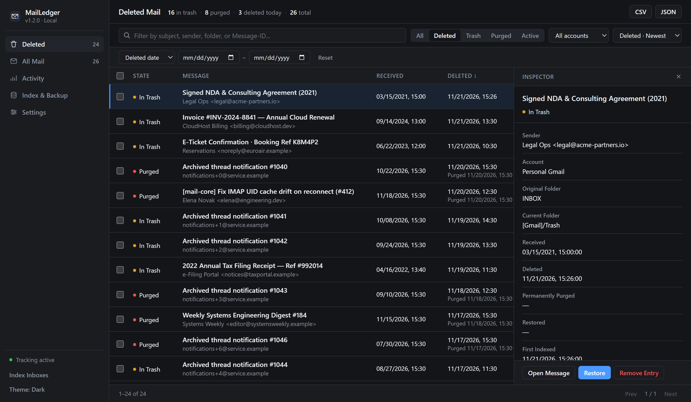
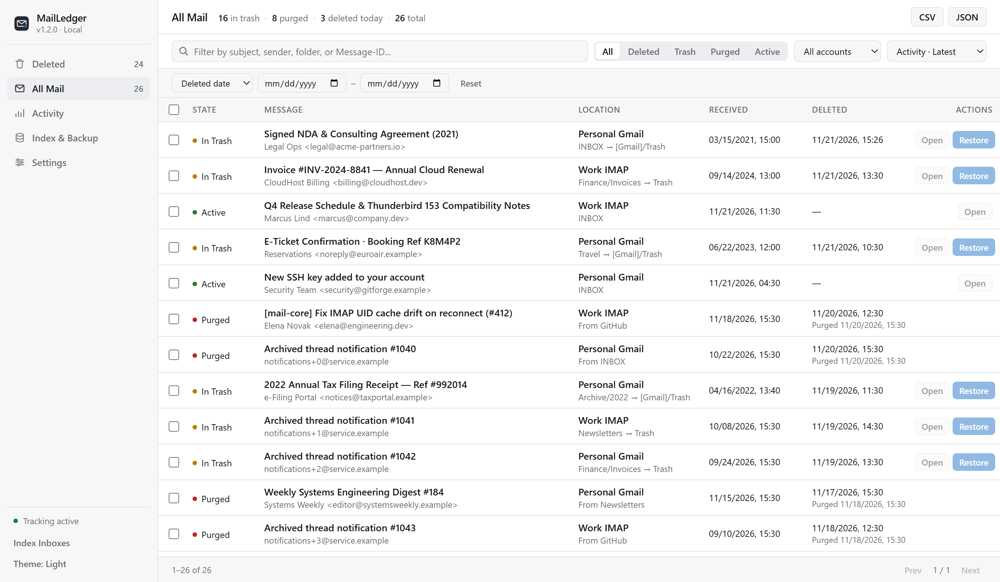
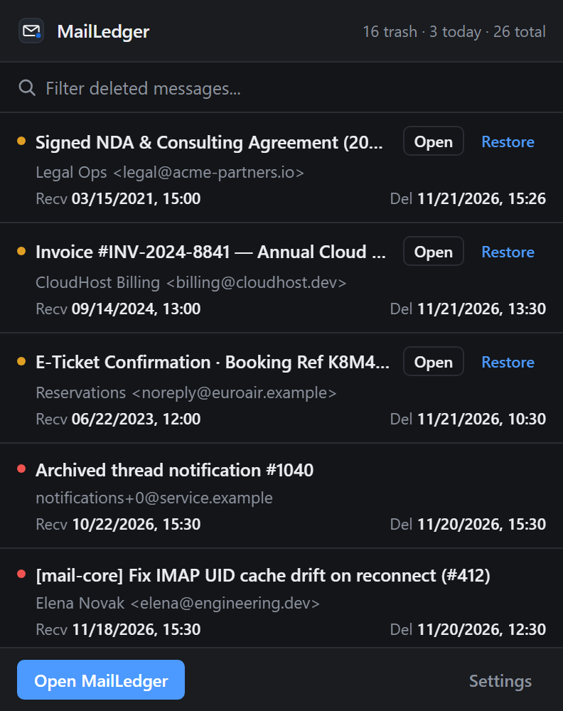
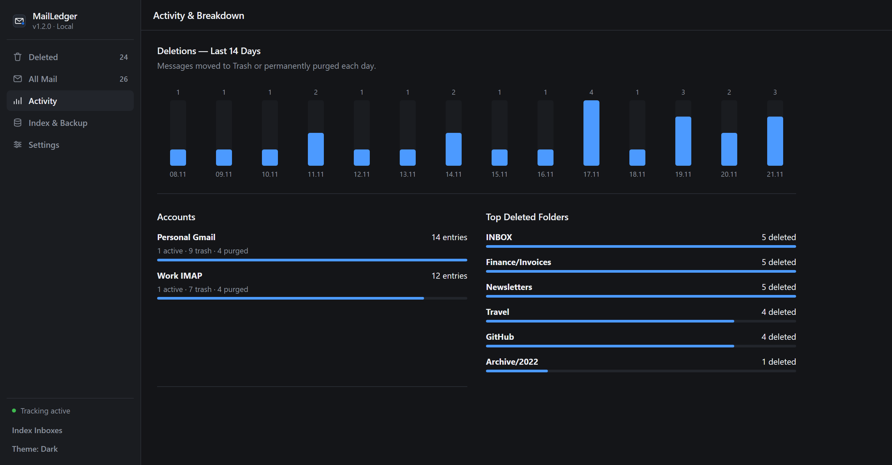

<p align="center">
  
</p>

<p align="center">
  <a href="https://github.com/bcankara/MailLedger/actions/workflows/ci.yml">
    
  </a>
  
  
  <a href="LICENSE">
    
  </a>
</p>

<p align="center">
  <a href="#english"><strong>English</strong></a> &nbsp;·&nbsp; <a href="#türkçe"><strong>Türkçe</strong></a> &nbsp;·&nbsp; <a href="https://github.com/bcankara/MailLedger/releases/latest"><strong>Download Latest .xpi</strong></a>
</p>

---

## English

### Why MailLedger?

In Gmail and most IMAP clients, the **Trash** folder sorts messages by their **original received date** rather than **when you deleted them**. If you accidentally delete an email from 2021, it sinks straight to the bottom of Trash behind hundreds of newer messages.

**MailLedger** is a lightweight, zero-dependency **Thunderbird Manifest V3** add-on that maintains a local chronological audit ledger of your incoming messages and exact deletion timestamps — letting you find, inspect, and restore recently deleted emails in seconds regardless of how old they are.

---

### Screenshots

#### Dedicated Workspace — Dark Mode & Docked Inspector
<p align="center">
  
</p>

#### All Mail Ledger — Light Mode
<p align="center">
  
</p>

#### Toolbar Quick Popover & 14-Day Activity View
<table>
  <tr>
    <td width="33%" valign="top">
      
    </td>
    <td width="67%" valign="top">
      
    </td>
  </tr>
</table>

---

### Key Features

* **Three Integrated Desktop Surfaces**
  * **Toolbar Quick Popover (`ui/popup.html`):** Displays a Trash badge counter on the unified toolbar icon, live inline metrics, instant search, and one-click **Open** / **Restore** for your latest deletions.
  * **Full Dedicated Workspace (`ui/dashboard.html` — Spaces Toolbar):** Split-pane desktop layout with *Deleted*, *All Mail*, *Activity*, *Index & Backup*, and *Settings* views plus a docked right-hand **Inspector** pane.
  * **Native Add-on Preferences (`ui/options.html`):** Accessible directly inside Thunderbird's Add-ons Manager.
* **Accurate Deletion Tracking (New & Pre-existing Mail):**
  * Automatically logs newly received mail (`messages.onNewMailReceived`), moves into/out of Trash (`messages.onMoved`), and permanent purges or `Shift+Delete` (`messages.onDeleted`).
  * Deleting a 5-year-old email preserves its original received date alongside the exact timestamp of deletion and its source folder.
* **Powerful Filtering, Bulk Actions & One-Click Restore:**
  * Search by subject, sender, folder, account, or `Message-ID`; filter by state, account, or **received/deletion date range**; sort by any column; bulk-restore trashed messages to their original folders (falling back safely to the account's Inbox if the original folder was removed).
* **Backfill & Portable Backups:**
  * Optional **Index Inboxes** and **Index Trash** tools (pre-install Trash items are honestly labeled *Pre-install* instead of fabricating fake timestamps).
  * Export to **UTF-8 BOM CSV** (spreadsheet/Excel-ready) or full **JSON backup**, and merge JSON backups safely without clobbering newer deletion timestamps.
* **Automatic Thunderbird Localization (English Default + Turkish):**
  * Automatically follows Thunderbird's UI language via WebExtension `_locales/` (`en` default fallback, `tr` full localization), with an optional manual language override in Settings.
* **100% Local & Private:**
  * Zero network requests, zero telemetry, zero external dependencies. Only message metadata (subject, sender, timestamps, folder path, `Message-ID`) is stored in Thunderbird's local extension storage — never email bodies.

---

### Installation

1. Download **`MailLedger.xpi`** from the **[Releases](https://github.com/bcankara/MailLedger/releases/latest)** page.
2. Open **Thunderbird** (128 ESR or newer) and press **`Ctrl + Shift + A`** (macOS: `Cmd + Shift + A`) to open **Add-ons and Themes**.
3. Click the **gear icon** in the top-right corner and select **Install Add-on From File...**
4. Choose `MailLedger.xpi` and click **Add**.
5. Open **MailLedger** anytime from the left **Spaces Toolbar** or click the **MailLedger** icon on the top toolbar.

---

### Development, Testing & Building

Requires **Node.js 22+** (syntax check & unit/integration tests) and **Python 3.10+** (deterministic POSIX `.xpi` packaging). Zero `npm` or `pip` dependencies are required.

```bash
# Check JS syntax across all modules
npm run check

# Run unit, i18n parity, and mocked-API integration tests
npm test

# Build and validate dist/MailLedger.xpi
npm run build
```

---

## Türkçe

### MailLedger Nedir?

Gmail ve çoğu IMAP hesabında **Çöp Kutusu**, mailleri **silinme tarihine göre değil, orijinal gelme tarihine göre** sıralar. Yıllar önce gelmiş bir maili yanlışlıkla sildiğinizde yüzlerce yeni mailin en dibinde kaybolur.

**MailLedger**, **Thunderbird 128+ (Manifest V3)** için geliştirilmiş, sıfır harici bağımlılıklı ve tamamen yerel çalışan bir e-posta kayıt defteri eklentisidir. Gelen maillerin konu/gönderen bilgilerini, geliş tarihlerini ve tam silinme tarihlerini kaydeder; kaç yıllık olursa olsun son sildiğiniz mailleri saniyeler içinde bulup tek tıkla geri yüklemenizi sağlar.

### Öne Çıkan Özellikler

* **Thunderbird Dilini Otomatik Algılar:** Eklenti varsayılan olarak **İngilizce** gelir ve tam **Türkçe** dil desteği sunar. Thunderbird'ü Türkçe kullanıyorsanız arayüz, tarih biçimi ve CSV başlıkları otomatik olarak Türkçe açılır; isterseniz Ayarlar bölümünden dili manuel olarak da değiştirebilirsiniz.
* **3 Bütünleşik Masaüstü Yüzeyi:**
  * **Üst Araç Çubuğu Açılır Penceresi:** Rozet sayacı, hızlı arama ve en son silinen mailler için tek tıkla **Aç** / **Geri Yükle**.
  * **Özel Tam Çalışma Alanı (Alanlar Çubuğu / Space):** *Silinenler*, *Tüm Mailler*, *Aktivite*, *Tarama & Yedek* ve *Ayarlar* görünümleri ile sağa sabitlenen **Ayrıntı** paneli.
  * **Yerel Eklenti Tercihleri:** Thunderbird Eklentiler Yöneticisi içinden doğrudan erişilebilir ayarlar.
* **Eski Maillerde de Tam Silme Takibi:** Eklenti kurulmadan yıllar önce gelmiş bir maili sildiğinizde, orijinal geliş tarihini koruyarak tam silinme zamanını ve eski klasörünü kaydeder.
* **Gelişmiş Filtreleme, Toplu Geri Yükleme ve Yedekleme:** Türkçe karakter duyarlı (`İ/i/I/ı`) arama, tarih aralığı filtresi, son 14 günlük silme grafiği, mevcut Gelen/Çöp Kutusu taraması *(kurulum öncesi silinmiş maillere sahte tarih yazmaz, "Kurulum öncesi" olarak işaretler)*, Excel uyumlu **UTF-8 BOM CSV** dışa aktarım ve birleştirilebilir **JSON yedekleme**.
* **%100 Yerel ve Gizlilik Odaklı:** Dış sunucuya hiçbir veri gönderilmez; e-posta içerikleri değil yalnızca üstbilgi verileri Thunderbird'ün yerel deposunda saklanır.

### Kurulum

1. **[Releases](https://github.com/bcankara/MailLedger/releases/latest)** sayfasından en güncel **`MailLedger.xpi`** dosyasını indirin.
2. **Thunderbird** (128+)'ü açıp **`Ctrl + Shift + A`** kısayolu ile **Eklentiler ve Temalar** sekmesine geçin.
3. Sağ üstteki **dişli simgesine** tıklayıp **Dosyadan eklenti kur...** (*Install Add-on From File...*) seçeneğini seçin.
4. `MailLedger.xpi` dosyasını seçip onaylayın (**Ekle**).

---

## License

Released under the [MIT License](LICENSE).
